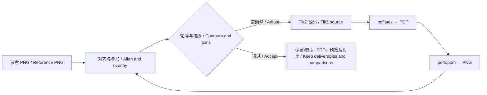

# 两幅 PNG 的 TikZ 重绘说明 / Implementation Notes for Two TikZ Reconstructions

## 中文

这两项任务采用类似“分层剪纸”的方法：把图片拆成轮廓、色块和细节，先画后面的部分，再叠加前面的部分。PNG 用于观察、取色和对照，最终 PDF 不嵌入原始位图。

### 共同实现原则

- 使用 `standalone` 文档类和 TikZ 基础功能，主要命令为 `\path`、`\fill`、`\draw`、`\shade` 和 `\clip`，不依赖自动描摹工具或复杂绘图库。
- 使用三次 Bézier 曲线拟合主要轮廓。端点控制特征位置，两个控制点控制进入、离开端点的方向及弯曲程度。
- 设置 `x=.75bp, y=-.75bp`，将原图像素位置直接用作绘图坐标。负的 y 方向让坐标向下增长，与图像坐标一致。
- 用 `use as bounding box` 确定画布范围，再用矩形裁切保持原图构图。当前两个文件都保留 `3.14pt` 的页面外边距；叠加对照时先扣除这部分边距。
- 颜色集中定义，描边使用少量命名样式，代码只保留简短的分区注释。
- 目标是用可编辑的平滑矢量图尽量接近参考图，而不是逐像素复制低分辨率图中的锯齿和压缩痕迹。

### 任务一：彩虹鬃毛鸭形角色

**输入：** [example-image.png](example-image.png)，898 × 633 像素。  
**输出：** [mwe.tex](mwe.tex)、[mwe.pdf](mwe.pdf)、[mwe.png](mwe.png)。

#### 实现思路

第一张图以平涂色块为主，重点是轮廓、比例和遮挡关系。大部分形状用封闭 Bézier 路径填色，细节用描边补充；渐变只用于虹膜等必要位置。彩虹毛发采用叠加色块，而不是沿边缘生成大量细碎路径。

#### 具体步骤

1. **分析原图与关键位置。**
   读取图像尺寸，统计主要颜色，单独放大头部、双眼、喙、翅膀、尾巴和水纹。通过坐标网格确定耳尖、发梢、眼角、喙尖等特征点。

2. **建立配色和描边样式。**
   从大面积纯色区域采样，定义身体蓝、彩虹色、喙灰、面部深色以及描边色。避免直接把抗锯齿边缘的混合颜色当作主体填色。

3. **按遮挡关系安排绘制顺序。**
   先画后方水纹和尾巴，再画身体、翅膀和鬃毛；随后绘制远侧眼睛、面部黑块、近侧眼睛、刘海和喙，最后补前景水纹。前景形状自然覆盖后面的形状。

4. **用少量连续曲线描述轮廓。**
   在明显转折处设置端点，用 `.. controls ... and ... ..` 调整曲率。身体和喙采用较长的平滑曲线，发梢、耳尖等位置保留尖角。

5. **添加内部结构。**
   眼睛分为眼白、渐变虹膜、黑色瞳孔和白色高光；翅膀用几条曲线表达羽片。刘海色块放在裁切范围内，避免越出轮廓。水纹使用两条封闭轮廓配合 `even odd rule`，形成宽度可变化的环带。

6. **针对鼻部黑块修正贴合。**
   黑块的可见形状不仅取决于自身路径，也受眼睛和喙的遮挡影响。因此同时校正黑块轮廓、右眼左缘、喙上缘和绘制顺序，避免只移动黑块却留下新的缝隙或错误重叠。

7. **完成五轮针对性校对。**
   分别检查黑块轮廓、与喙的接缝、双眼遮挡、描边和比例，以及完整画面。每轮通过实际 PDF 渲染结果判断，而不是只看源码或以编译成功作为完成标准。

#### 关键注意点

局部形状不准确，原因可能是相邻图形的位置或遮挡顺序不对。应检查整个交接区域，而不是只修改被指出的色块。

### 任务二：带皇冠与独角的角色头像

**输入：** [exampla-image2.png](exampla-image2.png)，275 × 485 像素。实际文件名为 `exampla-image2.png`，与最初请求中的 `example-image2.png` 拼写不同。  
**输出：** [mwe2.tex](mwe2.tex)、[mwe2.pdf](mwe2.pdf)、[mwe2.png](mwe2.png)。

#### 实现思路

第二张图的难点是渐变鬃毛、眼睛遮挡、皇冠内部对齐，以及独角分段弧线与外轮廓的连接。因此继续使用基础曲线和色块，但在局部增加渐变、裁切和几何接点计算。

#### 具体步骤

1. **建立参考坐标与局部观察图。**
   以 275 × 485 的原图坐标作为绘图范围，单独放大眼睛、皇冠、独角、刘海和颈部。记录轮廓、色带边界、宝石位置和分段线的位置。

2. **从背景向前分层绘制。**
   绘制顺序为背景、后方鬃毛、脸和颈部、双眼、刘海、独角、皇冠、项圈。这个顺序表达了皇冠覆盖独角、刘海覆盖眼睛上缘等关系。

3. **用简单渐变还原色带。**
   背景、鬃毛和虹膜使用 `\shade`。刘海使用 `shading angle=55` 的倾斜渐变；颜色和方向通过采样、渲染对照调整。浅黄色鬃毛分别处理上部较亮区域、过渡区域和下部纯色区域。

4. **在局部轮廓内裁切。**
   近侧眼睛先建立裁切区域，再绘制眼白、虹膜、瞳孔和高光，最后补眼睑与睫毛。刘海也先裁切再填色，避免渐变矩形或色带越过外轮廓。

5. **进行五轮整体与局部校对。**
   按整体轮廓、面部细节、遮挡与色块接缝、描边和比例、完整画面的顺序检查。调整过眼睛高光、口鼻轮廓、独角宽度、鬃毛渐变和刘海边界。

6. **针对皇冠做独立对齐检查。**
   对比顶部圆宝石、竖杆、下方菱形宝石和左右卷饰的位置。原图上下宝石本身略有错轴，因此没有把皇冠整体强行平移到几何中心，而是局部调整圆宝石中心与宽度、竖杆位置，以及菱形宝石的高度。

7. **修正独角分段线的断口与凸点。**
   原先部分弧线终点没有到达外轮廓，起点又略微越界。修正时按实际 Bézier 外轮廓计算接点，将六条分段线的端点放到边界上；在 `scope` 内先 `\clip`，再填充底色、绘制内部弧线，弧线使用 `line cap=butt`。退出裁切区域后重描外轮廓，让接头连续且边缘干净。

8. **验证修改范围。**
   重新编译并生成高分辨率预览，比较修改前后的图像。独角修正后，独角以下区域没有像素变化；端点到外轮廓的数值距离检查也通过。皇冠和其他部位不随这次修正移动。

#### 关键注意点

- “居中”应以原图的特征关系为准，不一定意味着所有部件共享同一条竖直中轴。
- 仅把线段画得更长不能稳定消除接头问题；应同时处理接点、裁切和外轮廓的绘制顺序。
- 在本次使用的 TikZ 中，将填色选项和 `clip` 混在同一条路径命令中曾触发编译错误。最终采用独立的 `\clip` 和 `\fill`，既清楚也可正常编译。

### 编译、对照与中间文件

具体命令和校对循环见文末的共享流程。两张图均已用 `pdflatex` 编译，并用 `pdftoppm` 渲染进行视觉检查；`pdfimages -list` 的检查结果没有列出位图图像对象。

当前保留的中间文件位于以下目录：

- [tmp/pdfs/mwe2-review/](tmp/pdfs/mwe2-review/)：第二张图各轮预览、局部放大和叠加对照。
- [tmp/pdfs/horn-lines-review/](tmp/pdfs/horn-lines-review/)：独角线条修正前后源码、整页预览、高清局部和对比图。

皇冠定点对照曾保存在 `tmp/pdfs/crown-adjust/`；撰写本文时，该目录已不在工作区。

此前恢复了 39 张第二张图及皇冠校对 PNG。其中 `review-4.png` 从保留的高分辨率页面图重建，其余使用内存中保留的图像或原生成步骤恢复。独角修正另保留了 11 张校对 PNG，以及 `before.tex` 和 `after.tex`。

## English

Both tasks use a layered paper-cut approach: separate the image into silhouettes, colored regions, and details; draw the rear elements first, then place the foreground elements on top. The PNGs are references for inspection, color sampling, and comparison, not embedded images in the final PDFs.

### Shared implementation principles

- Use the `standalone` document class and basic TikZ commands, primarily `\path`, `\fill`, `\draw`, `\shade`, and `\clip`. No automatic tracing tool or elaborate graphics library is required.
- Approximate the main outlines with cubic Bézier curves. Endpoints establish feature positions; the two control points determine tangent directions and curvature.
- Set `x=.75bp, y=-.75bp` so that source-image pixel positions can be used directly as drawing coordinates. The negative y unit makes coordinates increase downward, matching image coordinates.
- Define the canvas with `use as bounding box` and clip it to a rectangle to preserve the original composition. Both files currently retain a `3.14pt` page border; this border is excluded when aligning renders with the references.
- Centralize color definitions, use a few named stroke styles, and keep source comments limited to short section labels.
- Aim for an editable, smooth vector reconstruction that closely follows the reference, rather than reproducing the jagged pixels or compression artifacts of a low-resolution image.

### Task 1: The duck-shaped character with a rainbow mane

**Input:** [example-image.png](example-image.png), 898 × 633 pixels.  
**Outputs:** [mwe.tex](mwe.tex), [mwe.pdf](mwe.pdf), and [mwe.png](mwe.png).

#### Approach

The first image consists mostly of flat colors. Its main challenges are silhouette accuracy, proportions, and occlusion. Most shapes are filled, closed Bézier paths with additional strokes for details. Gradients are reserved for features such as the irises. The rainbow mane is built from overlapping colored shapes instead of numerous tiny traced paths.

#### Detailed steps

1. **Inspect the reference and locate key features.**
   Read the image dimensions, identify dominant colors, and enlarge the head, eyes, bill, wing, tail, and water ripples. Use coordinate grids to locate landmarks such as ear tips, hair tips, eye corners, and the tip of the bill.

2. **Define colors and stroke styles.**
   Sample large, flat regions to define the body blue, rainbow colors, bill gray, dark facial patch, and outlines. Avoid treating antialiased edge colors as the main fill colors.

3. **Choose the drawing order from the occlusion relationships.**
   Draw the rear ripples and tail first, followed by the body, wing, and mane. Then add the far eye, dark facial patch, near eye, forelock, and bill. Finish with the foreground ripple. Foreground shapes naturally cover the shapes behind them.

4. **Describe outlines with a small number of continuous curves.**
   Place endpoints at meaningful changes in direction and use `.. controls ... and ... ..` to tune curvature. Use longer, smooth curves for the body and bill while retaining sharp corners at hair and ear tips.

5. **Add internal structure.**
   Build each eye from the sclera, a shaded iris, a black pupil, and white highlights. Use a few curves to describe the wing feathers. Clip the forelock colors to its silhouette. Construct water rings from two closed contours using `even odd rule`, allowing the bands to vary in width.

6. **Correct the fit of the dark nose-area patch.**
   Its visible shape depends not only on its own path but also on how the eyes and bill overlap it. Adjust the patch contour, the left edge of the right eye, the upper bill boundary, and the drawing order together, rather than moving the patch alone and creating new gaps or overlaps.

7. **Complete five focused review rounds.**
   Check the patch contour, its seam with the bill, eye occlusion, strokes and proportions, and finally the complete image. Judge the actual rendered PDF, not merely the source code or whether compilation succeeds.

#### Main pitfall

An inaccurate local shape may be caused by a neighboring shape or the layer order. Inspect the whole junction instead of editing only the colored region identified in the feedback.

### Task 2: The crowned unicorn portrait

**Input:** [exampla-image2.png](exampla-image2.png), 275 × 485 pixels. The actual filename is `exampla-image2.png`, which differs from `example-image2.png` in the original request.  
**Outputs:** [mwe2.tex](mwe2.tex), [mwe2.pdf](mwe2.pdf), and [mwe2.png](mwe2.png).

#### Approach

The second image requires gradient hair bands, eye occlusion, alignment within the crown, and clean connections between the horn's internal curves and its outer outline. The reconstruction therefore retains basic paths and fills while adding local shading, clipping, and geometric endpoint calculations.

#### Detailed steps

1. **Establish reference coordinates and detail views.**
   Use the original 275 × 485 coordinate system. Enlarge the eyes, crown, horn, forelock, and neck separately, recording their contours, color-band boundaries, jewel positions, and internal line locations.

2. **Draw from back to front.**
   Use this order: background, rear mane, face and neck, eyes, forelock, horn, crown, and collar. This naturally represents relationships such as the crown covering the horn and the forelock covering the upper eye edges.

3. **Reconstruct color bands with simple gradients.**
   Use `\shade` for the background, mane, and irises. Apply `shading angle=55` to the forelock, tuning the colors and direction through sampling and rendered comparisons. Treat the pale-yellow mane as a bright upper region, a transition region, and a solid lower region.

4. **Clip fills to local silhouettes.**
   Define a clipping region for the near eye, then draw its sclera, iris, pupil, and highlights before adding the eyelid and eyelashes. Similarly, clip the forelock before applying colors so that gradient rectangles and color bands cannot extend outside its outline.

5. **Complete five overall and local reviews.**
   Review the silhouette, facial details, occlusion and color seams, strokes and proportions, and the complete image. Adjustments include eye highlights, the muzzle contour, horn width, mane gradients, and the forelock boundary.

6. **Review crown alignment separately.**
   Compare the upper round jewel, central stem, lower diamond-shaped jewel, and side ornaments against the reference. The two jewels are slightly offset in the original, so the entire crown is not forced onto a single geometric centerline. Instead, adjust the upper jewel's center and width, the stem position, and the lower jewel's height locally.

7. **Repair gaps and protrusions in the horn's internal lines.**
   Some original curve endpoints stopped short of the outline, while some starting points extended beyond it. Calculate junctions on the actual Bézier outline and place all six internal curves on those boundaries. Inside a `scope`, apply `\clip`, fill the base color, and draw the internal curves with `line cap=butt`. Redraw the outer outline after leaving the clipping scope to obtain continuous joins and a clean silhouette.

8. **Verify the scope of the change.**
   Recompile and inspect high-resolution previews, comparing the before and after images. The horn correction changed no pixels below the horn, and numerical checks confirmed that the curve endpoints lie on the outline within the checked tolerance. The crown and other features remain in place.

#### Main pitfalls

- Centering should follow the reference's feature relationships; it does not necessarily mean aligning every component to the same vertical axis.
- Simply extending a line is not a reliable junction fix. Endpoint placement, clipping, and outline drawing order must work together.
- Combining fill options with `clip` in the same path command caused a compilation error with the TikZ setup used here. The final implementation uses separate `\clip` and `\fill` commands, which are clear and compile successfully.

### Compilation, comparison, and intermediate files

The shared workflow and commands appear below. Both drawings were compiled with `pdflatex` and rendered with `pdftoppm` for visual inspection. The `pdfimages -list` checks listed no raster image objects.

Intermediate files currently remain in these directories:

- [tmp/pdfs/mwe2-review/](tmp/pdfs/mwe2-review/): review renders, enlarged details, and overlays for the second drawing.
- [tmp/pdfs/horn-lines-review/](tmp/pdfs/horn-lines-review/): before/after source files, full-page renders, enlarged horn details, and comparison images.

The focused crown comparisons previously used `tmp/pdfs/crown-adjust/`; that directory is no longer present in the workspace at the time of writing.

A total of 39 PNGs from the second-image and crown reviews were restored. `review-4.png` was rebuilt from the retained high-resolution page image; the others were restored from retained image objects or their original generation steps. The horn correction additionally retains 11 review PNGs, plus `before.tex` and `after.tex`.

## 共享校对流程 / Shared review loop



## 编译与验证命令 / Compilation and verification commands

在当前项目目录执行。 / Run from the project directory.

```sh
pdflatex -interaction=nonstopmode -halt-on-error -file-line-error mwe.tex
pdftoppm -png -singlefile -r 192 mwe.pdf mwe

pdflatex -interaction=batchmode -halt-on-error -file-line-error mwe2.tex
pdftoppm -png -singlefile -r 288 mwe2.pdf mwe2

pdfimages -list mwe.pdf
pdfimages -list mwe2.pdf
```

独角局部校对使用过更高分辨率的整页渲染： / A higher-resolution page render was used for the focused horn review:

```sh
pdftoppm -png -singlefile -r 576 mwe2.pdf tmp/pdfs/horn-lines-review/after-page-highres
```

`pdfimages -list` 用于检查是否包含位图；它不能判断外形是否还原准确。视觉精度仍需通过同尺度对照、局部放大和叠加图检查。 / `pdfimages -list` checks for raster images; it does not establish visual fidelity. Shape accuracy still requires matched-scale comparisons, enlarged details, and overlays.
